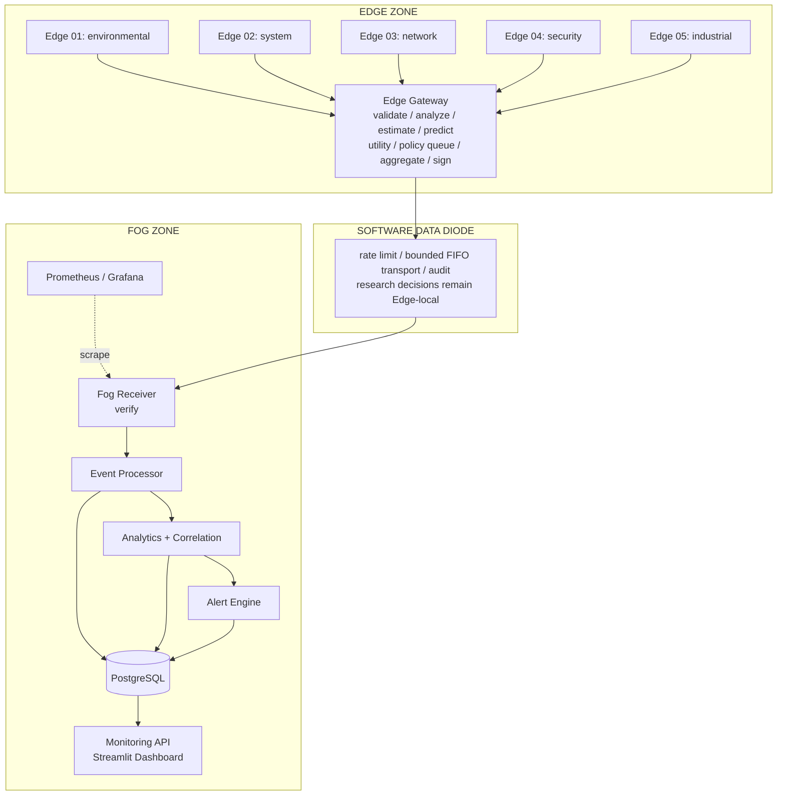
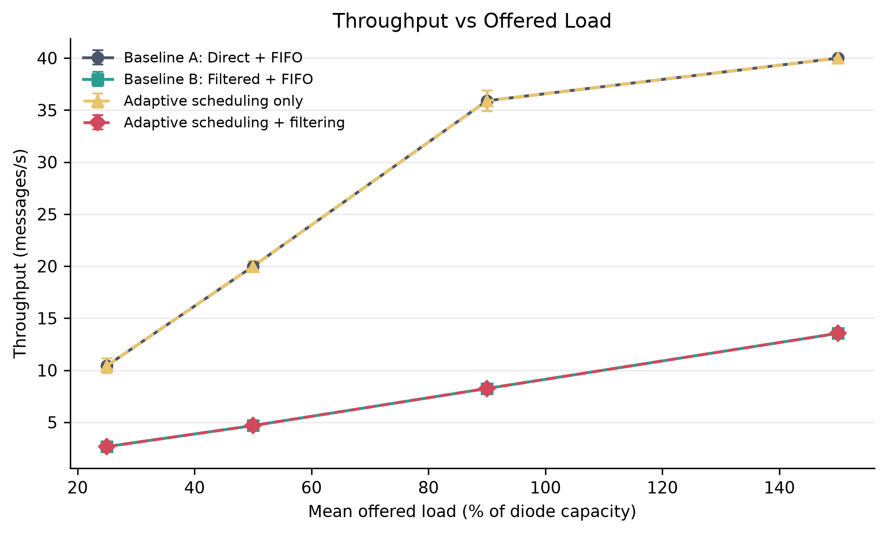
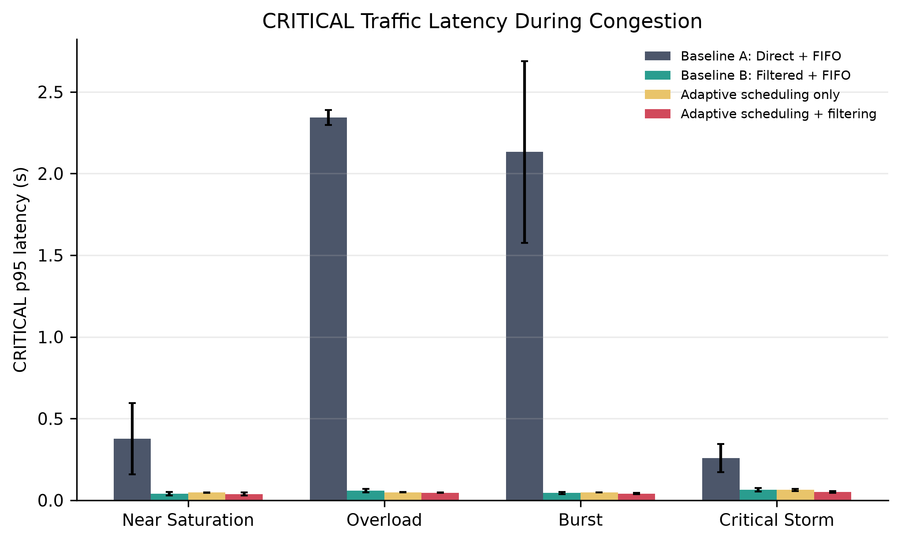

# Feedback-Free Information Preservation for Software-Defined Unidirectional Edge-Fog Gateways

## Continuous Integration

GitHub Actions checks pushes, pull requests and merge-queue commits using Python
regression tests, coverage, configuration/source validation and disposable Docker
delivery, security, persistence and recovery checks. See [CI setup and results](docs/ci.md)
for publishing the workflow, requiring the `CI Passed` check and adding future
phase tests. CI never deploys to your machine or uses your existing credentials.

## Codebase Audit and Upgrade

See the [2026-09-23 audit report](docs/codebase_audit.md) for fixes, reproducible test
evidence, remaining limitations, and the required stop-before-upgrade procedure for
the service-isolated runtime-file migration. Existing credentials and database volumes
must be retained.

## Standalone Phase 1 Baseline

For the minimum **one-device** pipeline with three logical networks, use
`docker compose -f docker-compose.phase1.yml up --build -d --wait`, then
`python scripts/verify_phase1.py`. See [Phase 1 setup and isolation checks](docs/phase1_architecture.md).
This independent Compose project preserves the full research system described below.

## Standalone Phase 2 Security

The next phased baseline adds signed envelopes and durable replay protection.
Run `docker compose -f docker-compose.phase2.yml run --build --rm key-init`, then
`docker compose -f docker-compose.phase2.yml up --build -d --wait` and
`python scripts/verify_phase2.py`. See [Phase 2 security and limitations](docs/phase2_security.md).
This remains one-device FIFO; utility scoring and prediction are intentionally deferred.

A locally reproducible research prototype that uses information utility and
local congestion prediction to select, delay, summarize, sample, supersede,
or discard Edge information before transmission into a Fog analytics zone.

> **Scope:** This is a software-defined/logically enforced unidirectional
> gateway prototype. It demonstrates architectural isolation and security
> mechanisms but cannot provide the absolute physical unidirectionality
> guarantees associated with hardware data diodes.

## Problem Statement

How can a unidirectional gateway autonomously preserve the most valuable Edge
information under changing bandwidth and congestion conditions when the
receiving Fog network cannot provide application-level feedback?

The proposed mechanism integrates an information analyzer, local state
estimator, deterministic congestion predictor, configurable utility score,
and six-action policy engine. Its decisions consume only Edge-local observations.
TCP acknowledgements still exist. Fog application responses, queue occupancy,
load, metrics, recommendations, and control messages do not enter this engine.
The integration is a research hypothesis, not an established novelty or patent claim.

The current research specification is [Feedback-free design](docs/feedback_free_design.md).
The [eight-phase map](docs/research_phases.md) distinguishes implemented software
from remaining evaluation work. [Manuscript draft](docs/research_manuscript.md)
states the contribution and measurement limits without claiming superiority.

## Objectives

- Isolate five independently configured Edge workloads from Fog services.
- Preserve integrity, authenticity, freshness, replay resistance, and message
  traceability across a forward-only application path.
- Reduce redundant Edge data and favor urgent traffic without an unbounded
  queue.
- Persist verified data and produce explainable anomalies, correlations, and
  alerts.
- Expose Fog-side visualization and zone-separated observability.
- Automate adversarial tests and repeated baseline/ablation benchmarks.
- Package the system for clean faculty evaluation and local reproduction.

## Architecture



## Information Preservation Mode

Docker Compose enables `INFORMATION_POLICY_ENABLED=true` by default. All eight
weights, novelty scales, capacity settings, thresholds, fairness limits, and
policy toggles are in `config/information_policy.json`, mounted read-only into
the Edge Gateway. The gateway assigns sequence numbers and signatures after
selection. The Data Diode uses FIFO transport in this mode to preserve that order.
Set `INFORMATION_POLICY_ENABLED=false` to reproduce the historical Phase 3
filter/scheduler behavior. Historical phase documents describe that older mode.

The Scheduler dashboard shows policy decisions exported through the existing
forward observability path. The dashboard continues to read only Fog data.

```powershell
python -m pytest -q
python -m experiments.runners.information_benchmark --output experiments/results/information-run-01
python -m experiments.analysis.information_report experiments/results/information-run-01
docker compose --profile full up --build -d
```

Use a new output directory for each benchmark run. The new runner executes five
paired trials for seven strategies and seven workloads, retains the configuration,
source hashes, seeds, timestamps, workload traces, decisions, queue histories,
raw trial CSVs, confidence intervals, and regenerable figures. Its measurements
are simulations of the deployed policy engine, not Docker or network benchmarks.

Edge performs generation, preprocessing, filtering, local priority assignment,
sequence allocation, and signing. The Data Diode performs admission control,
bounded queuing, adaptive/FIFO scheduling, congestion control, and one-way
forwarding. Fog performs verification, aggregation, persistence, anomaly
detection, cross-device correlation, alerting, and visualization preparation.

Docker uses five `internal` service networks. Separate Edge and Fog host-access
networks publish demonstration interfaces without joining the two zones. The
Data Diode bridges only the gateway side and Fog ingress; the Fog Receiver has
no Edge network membership. The dashboard reads PostgreSQL through the
Fog-only Monitoring API and never calls Edge services.

## What "Software Data Diode" Means

The prototype combines an intentionally forward-only service graph with Docker
network membership, no reverse API, cryptographic envelopes, source checks,
bounded transport, and automated Fog-to-Edge connectivity failure tests. These
are meaningful software controls, but a host administrator can alter them.
Physical one-way assurance requires hardware whose transmit and receive path
cannot be reversed in software.

## Features

- Five concurrent seeded telemetry generators with per-device configuration
- Per-device sequence, rate, health, activity, filtering, and priority state
- Pydantic schemas, SHA-256 payload hashes, and Ed25519 signatures
- Timestamp, UUID duplicate, and per-device replay protection
- Edge deduplication, significance filtering, sampling, and aggregation
- FIFO and explainable adaptive scheduling with starvation aging
- Token-bucket limits and priority-aware bounded-queue overflow
- Hash-chained audit logs and structured JSON service logs
- PostgreSQL migrations for telemetry, rejections, anomalies, alerts, security,
  experiments, performance, and observability
- Threshold, moving-average deviation, and z-score anomaly detection
- Configurable multi-device correlation and four alert severity levels
- Streamlit dashboard plus provisioned Prometheus and Grafana
- Isolated attacks, reverse-path tests, CSV reports, and audit tamper detection
- Reproducible baselines, ablations, repeated trials, confidence intervals, raw
  CSV data, and publication-ready PNG/PDF graphs

## Technology

Python 3.11, FastAPI, Pydantic, Uvicorn, HTTPX, Ed25519 via
`cryptography`, PostgreSQL/psycopg, Streamlit, Prometheus, Grafana,
pytest, pandas, Plotly, matplotlib, Docker, and Docker Compose.
Runtime and development Python versions are exactly pinned.

## Install

Prerequisites are Docker Desktop with Compose v2 and Python 3.11 or newer.
From this directory in PowerShell:

```powershell
python -m venv .venv
.\.venv\Scripts\python.exe -m pip install --upgrade pip
.\.venv\Scripts\python.exe -m pip install -r requirements-dev.txt
.\.venv\Scripts\python.exe scripts\setup.py
.\.venv\Scripts\python.exe scripts\validate_config.py
```

Setup creates a git-ignored `.env` with random local passwords/tokens and
generates git-ignored signing keys only if they do not exist.

## Run

Core data path and database:

```powershell
docker compose --profile core up --build -d
```

Complete system with dashboard and observability:

```powershell
docker compose --profile full up --build -d
docker compose --profile full ps
```

Open:

| Service | Local URL |
|---|---|
| Edge Gateway | http://127.0.0.1:8000 |
| Streamlit dashboard | http://127.0.0.1:8501 |
| Fog Prometheus | http://127.0.0.1:9090 |
| Edge Prometheus | http://127.0.0.1:9091 |
| Grafana | http://127.0.0.1:3000 |

Development ports are published by Docker Desktop so the host browser can reach
them. Keep Windows Firewall enabled and do not expose these ports on an
untrusted network. Grafana credentials are in your local `.env`. Stop without
deleting data:

```powershell
docker compose --profile full down
```

## Test

Run all local unit and code-level integration checks:

```powershell
.\.venv\Scripts\python.exe scripts\run_all_tests.py --local-only
```

Run the unified configuration, unit, Docker integration, and isolated security
suite:

```powershell
docker compose --profile full down
.\.venv\Scripts\python.exe scripts\run_all_tests.py
```

Run only adversarial validation:

```powershell
.\scripts\run_security_tests.ps1
```

Reports are written to `security-reports/`. The attacks remain inside a
dedicated local Compose project.

## Demo

With the `full` profile healthy:

```powershell
.\.venv\Scripts\python.exe scripts\demo.py
```

The deterministic sequence sends normal, HIGH, and CRITICAL telemetry, a
tampered envelope, replay attempt, congestion burst, scheduler snapshot, and Fog
anomaly. Evidence is saved to `demo-results/latest.json`. Use
`--start-stack --stop-after` for a self-contained run.

## Experiments

Run all 120 default trials:

```powershell
.\.venv\Scripts\python.exe scripts\run_experiments.py
```

Regenerate tables and figures from retained raw CSV:

```powershell
.\.venv\Scripts\python.exe -m experiments.analysis.analyze --result-dir experiments\results\phase7
```

The design compares direct+FIFO, filtering+FIFO, adaptive-only, and
filtering+adaptive under six loads with five paired seeded runs each.

## Results

The retained run contains 120 trials and 114,212 message records. The proposed
configuration measured 48.5% to 67.3% bandwidth saving across the six
workloads. Against unfiltered FIFO, adaptive scheduling reduced measured
CRITICAL p95 latency by 6.1% at light load, 29.9% at moderate load, 87.4% near
saturation, and 97.9% under overload. Under these traces LOW starvation was the
same for FIFO and adaptive scheduling. Full means, standard deviations, and 95%
confidence intervals are in the generated report; no general superiority claim
is inferred from one environment.





## Documentation

- [Architecture](docs/architecture.md)
- [Threat model](docs/threat_model.md)
- [Security design](docs/security_design.md)
- [Adaptive scheduler](docs/adaptive_scheduler.md)
- [Fog analytics](docs/fog_analytics.md)
- [Experiments](docs/experiments.md)
- [Deployment and recovery](docs/deployment.md)
- [Faculty demonstration](docs/faculty_demo.md)
- [Limitations](docs/limitations.md)
- [Future work](docs/future_work.md)
- [Generated experiment report](experiments/results/phase7/experiment_summary.md)
- [N10 coverage experiments and local commands](experiments/README-coverage.md)
- [N10 repeated-trial findings and limitations](docs/novelty-roadmap/reports/N10.md)
- [N11 local PowerShell setup/start/demo/stop/restart](docs/novelty-roadmap/local-demo.md)
- [Faculty explanation and disclosure draft: NOT FILED, NOVELTY UNESTABLISHED](docs/novelty-roadmap/invention-disclosure.md)
- [N11 verification evidence and operating limits](docs/novelty-roadmap/reports/N11.md)

## Known Limitations

The boundary is software-enforced, not physically unidirectional. Queues,
replay windows, device state, and analytics windows are in memory. Keys are
file-based and shared at the gateway. Default analytics require domain
calibration. The UI is a local demonstration interface, and Phase 7 resource and
latency values characterize its deterministic harness rather than a hardware
deployment. See [limitations](docs/limitations.md) for the complete scope.
