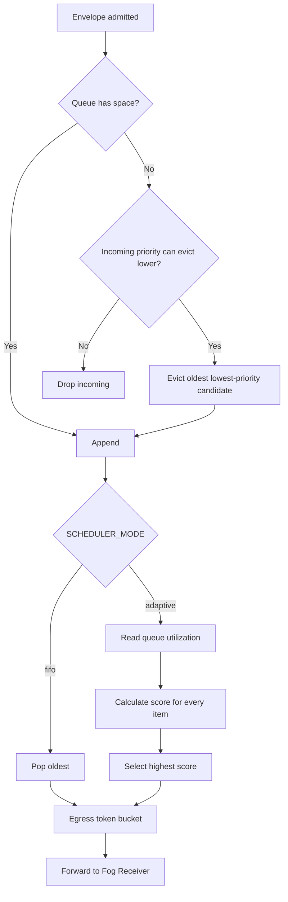

# Adaptive Scheduler

## Current Research Mode

With `INFORMATION_POLICY_ENABLED=true` (the Compose default), the Edge Gateway
runs the eight-term information-utility engine **before signing**. Its estimator,
predictor, six actions, fairness rules, and alternative density strategy are
documented in [Feedback-free design](feedback_free_design.md). The Data Diode
then uses FIFO transport to preserve signed sequence order. Configure the research
weights and rules in `config/information_policy.json`.

## Historical Phase 3 Mode

The remainder describes `INFORMATION_POLICY_ENABLED=false`. Its score is not
the new research formula and it should not be used to claim validation of that formula.

The Data Diode supports `fifo` and `adaptive` scheduling. Both modes use the
same bounded queue, rate limits, egress capacity, and workload envelopes so the
Phase 7 comparison changes only the intended feature.

## Score

For queued item `i`, the adaptive score is:

```text
score(i) =
  Wp * effective_priority
  + Wa * waiting_seconds
  + Wu * urgency
  + Wc * congestion_factor
  + Ws * starvation_factor
  - Wt * estimated_transmission_cost
```

Priority has values LOW=1 through CRITICAL=4. Waiting time gradually raises
effective priority, capped at CRITICAL. The starvation term starts after
`STARVATION_AFTER_SECONDS` and is capped. Urgency is explainable from priority
and telemetry thresholds. Equal scores retain arrival order.

## Scheduler Flow



## Congestion

Queue utilization maps to `NORMAL` below 50%, `ELEVATED` at 50%,
`CONGESTED` at 75%, and `CRITICAL` at 90%. The state affects scoring and is
reported in runtime metrics. Queue size never exceeds `MAX_QUEUE_SIZE`.

## Tuning

All weights, aging thresholds, queue capacity, and token-bucket rates are in
`.env.example`. Validate changes with:

```powershell
.\.venv\Scripts\python.exe scripts\validate_config.py
.\.venv\Scripts\python.exe scripts\run_experiments.py
```

Higher priority weighting improves urgent-message preference but may increase
LOW waiting. Aging and starvation weights bound that tradeoff; they do not
guarantee delivery when offered load permanently exceeds capacity.
