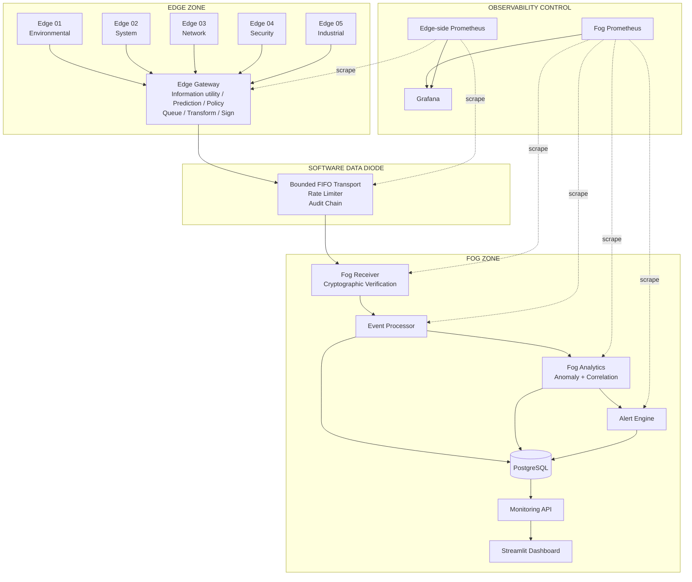
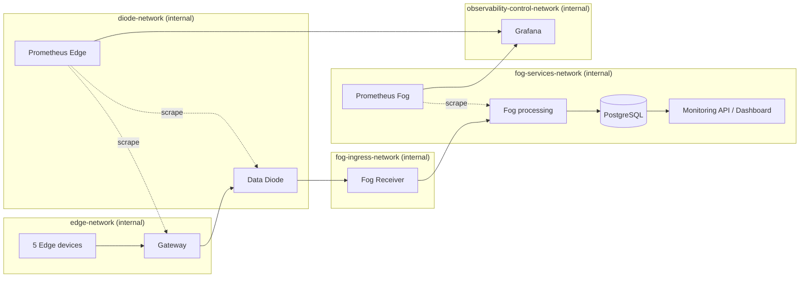
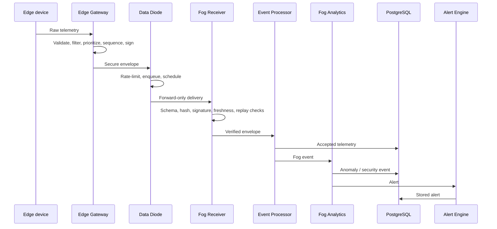

# Final Architecture

The current research mode is specified in [Feedback-free design](feedback_free_design.md).
It is a software-defined, logically enforced unidirectional communication gateway.
TCP acknowledgements are permitted; Fog application feedback does not drive its policy.

## Responsibility Boundaries

| Layer | Responsibilities |
|---|---|
| Edge devices | Generate domain telemetry with independent rates, seeds, and traffic profiles |
| Edge Gateway | Validate, track devices, analyze information, estimate local pressure, predict congestion, score utility, choose six actions, queue, then sign |
| Software Data Diode | Forward signed research output in FIFO order through bounded transport, rate-limit, audit; legacy adaptive scheduling remains available separately |
| Fog Receiver | Verify schema, hash, signature, timestamp, UUID, and sequence |
| Fog services | Persist events, detect anomalies, correlate devices, create alerts |
| Observability | Prepare Fog-side dashboard data and scrape zone-local metrics |

The dashboard reads only the Fog-side `monitoring-api`. It has no Edge or diode
network attachment.

## Full Architecture

## Trust Boundaries

The Data Diode is the only normal service attached to both `diode-network` and
`fog-ingress-network`. The Fog Receiver is not attached to `edge-network` or
`diode-network`, so Docker DNS and routing do not provide a Fog-to-Edge path.

## Message Data Flow

## Traceability

`message_id` is generated at the gateway and reused as `correlation_id` in JSON
logs. `device_id`, sequence number, priority, audit entries, database rows, and
Prometheus labels preserve a message's origin across the forward path.
