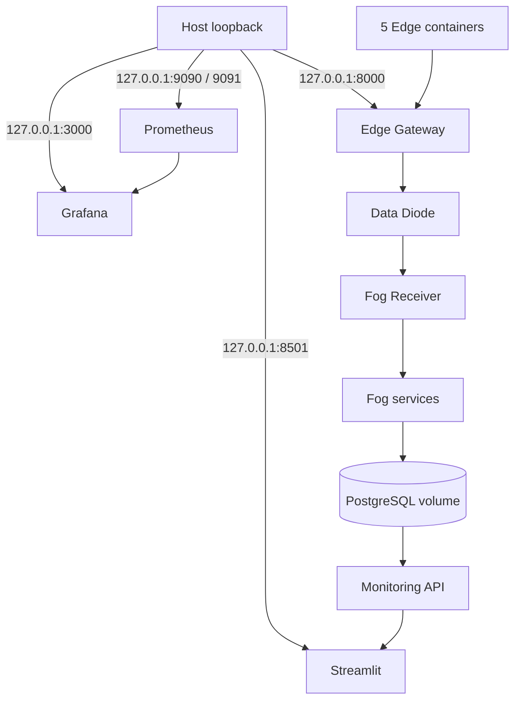

# Deployment and Operations

## Prerequisites

- Docker Desktop with Docker Compose v2
- Python 3.11 or newer for local scripts
- At least 4 GB of Docker memory for the `full` profile

Run every command from the repository root.

## Research Mode Upgrade

The project root for this workspace is
`C:\Users\Rithvik Kumar\Desktop\fogedge\software-data-diode`.
`INFORMATION_POLICY_ENABLED=true` is the Compose default. Policies and weights
are loaded from the read-only `config/information_policy.json` mount. Edit that
file locally and restart the gateway to apply operator-selected parameters.
Do not expose a Fog-controlled policy or configuration endpoint.

Research output is transformed before signing, uses schema version 2.0, and
travels in FIFO sequence order. Rebuild all Python images together after this
upgrade because the signed aggregation schema changed. Stop generators first
and allow pending traffic to drain before replacing a live stack; pending queues
are in memory. Keep existing keys, `.env`, and database volumes.

```powershell
docker compose --profile full up --build -d
docker compose --profile full ps
```

Use `INFORMATION_POLICY_ENABLED=false` only for the historical pipeline. The
current mechanism and validation limits are in [Feedback-free design](feedback_free_design.md).

## Clean Setup

```powershell
python -m venv .venv
.\.venv\Scripts\python.exe -m pip install --upgrade pip
.\.venv\Scripts\python.exe -m pip install -r requirements-dev.txt
.\.venv\Scripts\python.exe scripts\setup.py
.\.venv\Scripts\python.exe scripts\validate_config.py
```

`setup.py` creates `.env` with random local values, generates Ed25519 keys only
when absent, and creates runtime directories. It never overwrites existing
credentials or keys.

On Linux, ensure UID 10001 can write the bind-mounted `logs/` and
`security-reports/` directories. Windows Docker Desktop manages those bind
mount permissions.

## Profiles

```powershell
# Five devices, gateway, diode, Fog processing, migrations, PostgreSQL
docker compose --profile core up --build -d

# Core plus Streamlit, both Prometheus instances, and Grafana
docker compose --profile full up --build -d

# Controlled attacks in a disposable isolated project
.\scripts\run_security_tests.ps1
```

Stop the current deployment:

```powershell
docker compose --profile full down
```

Add `--volumes` only when intentionally deleting PostgreSQL, Prometheus, and
Grafana data.

## Deployment View



Docker Desktop publishes the listed development ports through separate
`edge-host-network` and `fog-host-network` bridges. The five data-path and
observability service networks remain `internal`, and the two host bridges are
never shared directly across Edge and Fog. Keep the host firewall enabled and
do not forward these ports from a router or expose them on an untrusted
network.

## Health and Readiness

`/health` reports that a process is alive. `/ready` checks the dependencies
needed to accept traffic. Gateway checks its signing key and the diode in the
forward direction; diode checks the receiver forward; Fog services check
PostgreSQL and their next Fog dependency. No readiness probe calls from Fog to
Edge.

```powershell
docker compose --profile full ps
Invoke-RestMethod http://127.0.0.1:8000/ready
docker compose --profile full exec -T postgres pg_isready -U fog -d fog_data
```

## Interfaces

| Interface | URL |
|---|---|
| Edge Gateway API | http://127.0.0.1:8000 |
| Streamlit | http://127.0.0.1:8501 |
| Fog Prometheus | http://127.0.0.1:9090 |
| Edge Prometheus | http://127.0.0.1:9091 |
| Grafana | http://127.0.0.1:3000 |

Grafana credentials come from local `.env`.

## Failure and Recovery

| Scenario | Observable behavior | Recovery |
|---|---|---|
| Fog Receiver offline | Diode readiness fails; forwarding logs errors; queue stays bounded | Compose restarts receiver; diode resumes forward attempts after it is healthy |
| PostgreSQL unavailable | Fog readiness is 503; writes return explicit 503/502; local security audit continues | PostgreSQL restarts; dependency health gates startup |
| Gateway restart | Devices log connection errors and retry future generation; sequence registry restarts | Compose restarts gateway; new signed traffic resumes |
| Diode restart | Gateway gets forwarding failure; in-memory queued entries are lost and logged state restarts | Compose restarts diode; readiness prevents premature dependency start |
| Malformed configuration | `validate_config.py` exits nonzero before deployment; invalid numeric startup values fail visibly | Correct `.env` or JSON, validate, restart |
| Queue overload | Token buckets return 429; queue remains bounded; overflow favors higher priority | Reduce offered load or tune capacity/rates from measured results |

The queue is intentionally in memory. Restart durability is not claimed.

## Unified Verification

Local checks only:

```powershell
.\.venv\Scripts\python.exe scripts\run_all_tests.py --local-only
```

Full unit, integration, and security verification:

```powershell
docker compose --profile full down
.\.venv\Scripts\python.exe scripts\run_all_tests.py
```

The full command validates configuration, runs pytest, builds a clean full
deployment in the isolated `software-data-diode-verification` Compose project,
waits for the data path, Streamlit, both Prometheus instances, and Grafana,
tests dependency outages and process restarts, removes its test volumes, then
runs the isolated adversarial suite.

## Operational Evidence

```powershell
docker compose --profile full logs --since 10m
.\scripts\inspect_networks.ps1 -ProjectName software-data-diode
.\scripts\export_audit_logs.ps1
.\.venv\Scripts\python.exe scripts\verify_audit_log.py logs\fog-receiver-audit.jsonl
```

Runtime audit files use the Docker-managed `audit-logs` volume so hardened
non-root containers can append reliably on Windows and Linux. Export a snapshot
before running host-side verification. If an audit log is empty, allow
telemetry to flow before exporting it.
