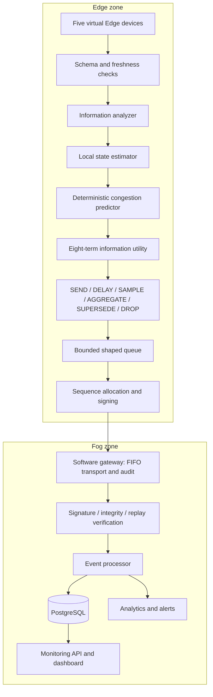

# Feedback-Free Information Preservation

Working title: **Feedback-Free Information Preservation for Software-Defined
Unidirectional Edge-Fog Gateways**.

Alternative formal title: **Locally Observable Information-Utility Control for
Logically Unidirectional Edge-to-Fog Telemetry**.

These are provisional titles because the request's title fields were blank.
The mechanism is a configurable, deterministic information-preservation policy.
Its novelty and patentability have not been established.

## Research Question and Boundary

How can a unidirectional gateway autonomously preserve the most valuable Edge
information under changing bandwidth and congestion conditions when the
receiving Fog network cannot provide application-level feedback?

This system is a software-defined, logically enforced unidirectional communication
gateway. It is not equivalent to a hardware data diode. Containers, administrators,
the host kernel, published ports, routing, and credentials remain in the trust model.
Network isolation reduces direct service reachability; it is not a physical guarantee.

Feedback-free adaptation excludes Fog application acknowledgements, CPU/queue/load
measurements, processing latency, congestion indicators, recommendations, and control
commands from scheduling, filtering, prediction, and information preservation.
TCP acknowledgement packets still travel in reverse. The transport implementation
records HTTP successes/failures for diagnosis. These results are not passed to
`InformationEngine`, which has no networking imports or receiver-state interface.

## Runtime Architecture



The gateway and transport together implement the unidirectional application path.
The research decision boundary is before the final cryptographic signature so
aggregation never modifies an already signed envelope. Edge inputs are the existing
trusted simulated devices, with schema and freshness checks; device authentication
is not newly claimed here. Unknown event types and abnormal states are conservatively
preserved. Final signatures, source times, and aggregate provenance protect the
transformed payload across the Edge-to-Fog boundary.

Research envelopes use schema version 2.0. Rebuild all Python images together when
upgrading, because the aggregate payload schema now includes additional signed fields.
Research mode bypasses the legacy independent EdgeFilter. Every schema-valid,
fresh, finite candidate gets its own UUID, score, and admission decision. A second
score is computed at scheduling time. Post-policy sequence allocation and FIFO
transport avoid receiver replay rejection caused by priority reordering. The original
measurement time is signed as `attributes.source_timestamp`; envelope `created_at`
is signing time. Aggregates also carry their observation window.

## Formula and Units

```
U = Wp*P + Wn*N + Wf*F + Wr*R + Wa*A + Ws*S - Wc*C - Wo*O
density = U / C
```

| Term | Definition |
|---|---|
| P | LOW=.25, MEDIUM=.5, HIGH=.75, CRITICAL=1 |
| N | Maximum absolute metric change / configured metric scale, clipped to [0,1]; status/schema change or unseen stream = 1 |
| F | exp(-sample_age / freshness_seconds); preserved events/state changes = 1 |
| R | Security event match = 1; otherwise maximum risk metric / configured scale, clipped to [0,1] |
| A | Local waiting time / starvation_seconds |
| S | max(A-1, 0), increasing without a fixed cap |
| C | max(1/messages_per_second, estimated_serialized_bytes/link_bytes_per_second), in seconds |
| O | 1 for superseded or expired routine information, otherwise 0 |

Weights are in `config/information_policy.json`; none are scattered among service
handlers. The default cost denominator is modeled transmission time, so density is
utility per modeled service second. The `density_under_pressure` strategy uses it
only in CRITICAL congestion. The normal utility strategy does not divide by cost.
The queue evaluates current novelty, age, and waiting time again at selection.

Novelty is per (device, telemetry type, event type, attributes). All numeric readings
are considered. Type-specific scales cover environmental temperature/humidity/AQI;
system CPU/memory/load; network packet rate/latency/loss; security failures/blocks;
and industrial pressure/vibration/RPM. Unconfigured numeric fields use a relative
change scale of max(abs(previous_value),1). This choice is explicit and should be
calibrated for real sensors.

The reference is the last **locally dispatched** state, not a confirmed Fog state.
Feedback-free operation cannot prove what Fog received. Network losses can therefore
make this reference diverge from receiver knowledge. Never label it confirmed delivery.

## Local State and Prediction

One-second history buckets retain arrivals, estimated byte sizes, local dispatches,
priority counts, drops, and aggregation events over the configured window. Reported
drain rate counts local dispatch attempts, independent of downstream status codes.
Service time is the configured message/byte shaping model, not Fog processing time.
Queue growth is updated only by queue operations; dashboard polling cannot change it.

```
capacity = min(configured_message_rate, configured_byte_rate / mean_size)
growth = max(arrival_rate-capacity, short_burst_rate-capacity, queue_growth, 0)
predicted_Q = Q + growth * prediction_horizon
pressure = max(Q/max_Q, predicted_Q/max_Q)
```

The configured thresholds map pressure to NORMAL, ELEVATED, CONGESTED, and CRITICAL.
Disabling prediction uses current queue utilization only. Startup uses a minimum
one-second observation denominator. The deterministic forecast is a heuristic;
forecast accuracy must be evaluated rather than assumed. No neural model is required.
Bandwidth changes enter through local operator/testbed configuration. The experiment
runner uses `configure_local_link` for a scheduled local capacity step.

## Actions and Safeguards

| Action | Actual effect and explicit reason |
|---|---|
| SEND | Remove selected candidate and consume modeled service time; record local dispatch |
| DELAY | Admit candidate to bounded queue for selection at a future service opportunity |
| AGGREGATE | Merge low-novelty routine readings with matching stream/metric sets before signing; retain count, means, extrema, window and source IDs |
| SAMPLE | Deterministically omit routine low-novelty candidates during CRITICAL pressure, keeping every configured Nth candidate |
| SUPERSEDE | Remove an older routine snapshot when a newer moderately changed snapshot replaces it under congestion |
| DROP | Reject oversized/expired candidates, evict lower-utility routine entries, or report exhausted queue capacity |

HIGH/CRITICAL messages, unknown/nonroutine events, abnormal states, security spikes,
and sufficiently novel state changes are protected against aggregation, sampling,
supersession, and routine expiration. At hard capacity, a CRITICAL candidate can
evict a lower-priority candidate, including novel state; this is explicitly audited
as overflow loss. Other admissions cannot evict protected candidates. If the queue is
entirely CRITICAL, new arrivals can still be dropped. No finite-capacity system
can promise lossless preservation under an unbounded critical storm.

Aggregation stores at most the configured sample count and cannot cross device,
telemetry type, event type, attributes, or priority. It preserves extrema but not
the exact sequence of samples. Completed aggregates cannot be superseded. Both
candidate and aggregate size are bounded using serialized size plus configured
envelope overhead. Actual HTTP, TCP, TLS, and retransmission bytes are not modeled.

Fairness has two mechanisms: increasing waiting/starvation score and an oldest-first
override for queued candidates exceeding `starvation_seconds`. The override favors
already admitted messages. It is not a hard end-to-end deadline or an admission
guarantee. Aggregation and supersession preserve waiting credit without confusing
that credit with source freshness. FIFO comparison disables this override.

Every decision emits its UUID, source UUIDs, action, reason, score, density, raw and
weighted components, and local congestion evidence into the hash-chained audit log.
Recent decisions also travel forward in observability snapshots into PostgreSQL.
The Fog dashboard reads that stored information; it does not poll Edge services.
Prometheus exposes `information_policy_actions_total`, `information_utility_score`,
`predicted_queue_size`, and the Edge policy `queue_size`. In research mode the
dashboard's reduction percentage uses estimated generated minus dispatched minus
pending-original bytes, so queued data is not incorrectly counted as bandwidth saving.
This is an estimate of policy reduction, not confirmed Fog delivery or on-wire bytes.

## Reproducible Evaluation

Run `python -m experiments.runners.information_benchmark --output <new-directory>`.
It compares FIFO, priority with aging, utility scheduling only, filtering only,
the proposal without prediction, the full proposal, and density under pressure.
All configurations receive identical paired-seed traces and capacity schedules.
The FIFO baseline uses tail-drop admission; the proposal's admission/eviction
policy is part of the treatment. This is disclosed rather than hidden as an
identical-buffer claim. Legacy Phase 7 code remains a historical comparison.

Workloads cover 25%, 50%, 90%, and 150% nominal capacity, a 3x burst, a critical
storm, and a 75% bandwidth reduction. Nominal offered load uses a configured
reference serialized message size. Actual utilization depends on actual candidate
size and aggregation overhead. Run at least five paired seeds; defaults use five.

The retained manifest contains fully resolved policy settings, configuration,
seed rules, start/end timestamps, source fingerprints, Python and platform versions.
Workload traces and decision JSONL retain raw experimental evidence. Trial and queue
CSVs support independent analysis. The report calculates mean, median, sample SD,
and Student-t 95% confidence intervals, with raw CSV beside each generated graph.
Missing priority samples stay missing. The runner refuses to overwrite an existing
result directory. Run `python -m experiments.analysis.information_report <directory>`
to regenerate figures without rerunning workloads.

Measured outcomes include modeled throughput, represented-sample latency quantiles,
critical preservation, estimated bandwidth saving, policy drops, LOW unavailability
or lateness, and runner CPU time. Aggregated representation is explicitly distinct
from exact sample recovery. Lost/sampled/superseded readings count against availability.
Security and anomaly **detection** are not inferred from message arrival in this runner.

## Remaining Limits

- This is a local simulation and software integration, not completed conference validation.
- Actual Docker throughput, memory, wireless loss, TCP backpressure, and packet-level
  isolation need testbed measurement. Network slowdown can fill the passive transport
  queue; the policy deliberately does not adapt from Fog acknowledgement timing.
- The current queue and history are in memory. Restarts lose unsent candidates and
  novelty history; signing sequence allocation retains its existing persisted state.
- Thresholds, freshness periods, and utility weights require domain calibration,
  sensitivity experiments, and task-specific information reconstruction metrics.
- The existing simulated Edge inputs are unsigned; input authentication is a separate
  trust-boundary question from signed gateway-to-Fog envelopes.
- Container/host compromise and privileged administrators are outside any physical
  one-way guarantee. Published development ports require a trusted local machine.
- Patentability and research novelty require prior-art analysis and independent review.
