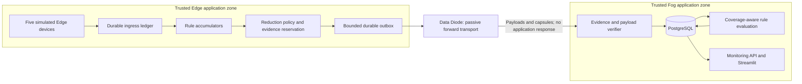

# RCCD technical specification

Status: N0 specification frozen; N1-N3 implemented/reported, N4 admission code verified, N5 transport, N6 Fog persistence and N7 coverage-aware rules/alerts implemented. Research mode remains disabled in the baseline deployment. N8-N11 remain proposed.
Version: roadmap-1 + N0-contract-v1. Date: 2026-10-13.
The normative v1 decisions are in [N0 contract freeze](reports/N0-contract-v1.md).
N0 adds baseline evidence only. N1 adds pure contracts and semantics. N2 adds a ledger-only opt-in path, not a coverage pipeline. See [N2 scope and recovery limits](reports/N2.md).
N3 adds separate signed artifacts, offline recomputation and an optional Edge-local signing journal, not live publication or byte reservations. See [N3 implementation report](reports/N3.md) and [v1 evidence format](reports/N3-format-v1.md).
N5 adds isolated UDP deployment, charged signed raw/state/evidence parts and bounded Fog replay/reassembly, with local no-reply/outage evidence. See [N5 report](reports/N5.md) and [transport contract](reports/N5-transport-v1.md). It records N4's missing report and does not implement N6 PostgreSQL verdict persistence.
N6 adds typed authenticated-summary verification, bounded Fog evidence spooling, additive PostgreSQL persistence, conflict quarantine and transactional publication. See [N6 report](reports/N6.md). It does not execute coverage rules, activate received contract transitions or remove N4 retention limits.
N7 integrates N1 semantics with signed persisted facts, checked original-witness references, revision history and idempotent/cooldown-controlled Alert Engine delivery. See [N7 report](reports/N7.md). Observation coverage remains independent of rule truth. Legacy received-payload analytics remains a named baseline; N8 visualization and N4 archival/retirement are not implemented here.

## 1. Main mechanism

RCCD couples telemetry reduction to the production and admission of evidence required by registered monitoring rules.

A rule-specific accumulator runs before filtering. The admission policy reserves a bounded amount of storage and forward bytes for its eventual closed-window evidence. Routine raw messages compete for the remaining budget. Fog evaluates received evidence conservatively instead of interpreting a lack of received alerts as a complete negative result.

The exact technical effect being tested is **correct, useful rule decisions per transmitted byte under forward-only loss and congestion**. A decrease in raw traffic alone does not establish success.

## 2. Operating and trust model

Two locally trusted application zones are connected in the permitted Edge-to-Fog direction. The purpose is to contain propagation from one zone to the other while exporting selected observations. Trust does not eliminate software faults, overload or link loss.

The new guarantee is scoped to observations accepted at the trusted Edge Gateway, before its filtering policy. That boundary must appear in capsules, experiment manifests and the UI. The current unsigned simulated device inputs do not establish cryptographic device identity. Gateway signatures authenticate gateway statements.

Assume the gateway's rule evaluator, admission ledger, configured keys and Fog verifier operate correctly. Test faulty transport, malformed artifacts, packet loss, duplicates, reordering, replay, transient database outages and crash recovery. A malicious trusted signer can lie about withheld observations; a signature or input root does not prove those statements true.

There is no guarantee about an unobserved physical event, a sample lost before gateway admission, an uninstrumented process, or a compromised sensor. An upstream outage may be detected through configured sample requirements, but every upstream omission cannot be inferred.

Docker separation and forward-only application code remain software controls. UDP by itself does not enforce one-way networking, and the shared host administrator can change connectivity. The new mode must not be described as a hardware-equivalent diode.

## 3. Research architecture



Keep current HTTP mode for existing baseline behavior. The research mode adds UDP across the diode-to-Fog application boundary so no Fog application success, failure, readiness reply, metrics reply or NACK influences the research sender.

Local request/response traffic within Edge and within Fog is permitted. The dashboard stays Fog-only. The host experiment harness may observe both zones but must not pass its observations back to the policy.

The existing Grafana control network also reaches Edge Prometheus. The future research override must remove this auxiliary cross-zone request path, using forward-exported Edge metrics on Fog instead. See the [N0 integration checklist](reports/N0-integration.md).

## 4. Initial supported rule language

Use a deliberately restricted, locally provisioned contract language:

- EXISTS: at least one accepted observation for a device and metric satisfies an inequality.
- COUNT_GE: the number of accepted observations satisfying that inequality is at least K.
- AND and OR over registered atomic conditions in the same aligned window.

Start with finite numeric values and explicit units. Support >, >=, < and <=; exact equality, arbitrary NOT, temporal ordering, continuous-time duration, trend inference and arbitrary Python expressions are outside v1.

All default windows are non-overlapping 10-second windows assigned from gateway ingress UTC, with monotonic elapsed time used for closure and timeout scheduling. The gateway is the common time authority for these scopes. Source timestamps remain provenance, not a replacement for the chosen window clock.

An example incident rule is:

```text
Within the same gateway-ingress window:
    EXISTS edge-device-02.cpu_usage >= 90
AND EXISTS edge-device-03.measurements.packets_per_second >= 8000
AND EXISTS edge-device-04.measurements.failed_logins >= 5
```

These are demonstration thresholds, not recommendations for a real plant or security system. The rule says the three observations occurred within the same window; it does not claim simultaneous physical events.

Provision the same immutable contract bytes separately in Edge and Fog through host-managed read-only files. Bind their canonical SHA-256 hash into every capsule. Apply a new contract at a new window boundary. A Fog-only experimental rule unknown to Edge cannot retroactively claim coverage of withheld values.

## 5. Observation identity and durability

Introduce observation identity before the policy:

```text
(gateway_ledger_epoch, device_id, ingress_sequence)
```

Keep the existing outgoing message UUID and transport sequence as separate identifiers. Do not infer the number of original observations from transport sequence gaps.

Store accepted observations, predicate accumulator updates, window membership, reduction disposition and evidence reservation in a bounded SQLite store on an Edge-only named volume. Use transactions, recovery checks and one serialized writer. A request is accepted only after its admission transaction commits.

Use bounded retention and explicit record/byte limits. If the store cannot durably admit work, return a local overload/error result and expose coverage limitations. Never acknowledge durable acceptance and later invent the corresponding record.

Recover open windows and reservations before new admission. A clock jump, uncertain time continuity or incomplete recovery produces an explicit limited scope, not fabricated historical normality.

## 6. Rule Coverage Capsule (RCC)

An RCC is an authenticated assertion from the trusted gateway, not a zero-knowledge proof of every omitted value.

Its signed body includes:

```text
protocol_version
artifact_kind
gateway_id
signing_key_id
ledger_epoch
capsule_id
contract_hash
device_id
window_id
window_start_utc
window_end_utc
time_basis
closure_reason
ingress_first_sequence
ingress_last_sequence
accepted_observation_count
input_commitment
per_condition_facts
coverage_limitations
reduction_accounting
previous_capsule_digest
created_at
```

Per-condition facts include matching, nonmatching and unresolved observation counts, plus the minimal sufficient values required by the supported predicate. Extrema and a compact witness reference can support inspection. Facts are calculated from original accepted observations before reduction, not from aggregate means.

For each condition:

```text
accepted_count = matching_count + nonmatching_count + unresolved_count
```

A missing metric contributes unresolved evidence. Record transport/reduction disposition separately: raw selection, reduction, hard drop and pending raw dispatch are not interchangeable with semantic coverage. A raw overflow can still be represented by a valid exact predicate fact if that fact was committed before the raw sample was dropped.

An input commitment binds the accepted ledger scope for later offline comparison. If Fog does not possess those raw inputs, it cannot independently recompute the predicate facts from that commitment. Label this assurance as AUTHENTICATED_SUMMARY. Offline recomputation from disclosed raw data is a separate verification mode.

Each window has self-contained facts. A lost earlier capsule creates a continuity gap, but must not automatically erase independently valid facts in a later window. A same-window fork or contradictory signed facts is a conflict requiring explicit handling.

Immutable capsule identity binds epoch, device, window and contract. Repeated delivery uses identical signed bytes. Reusing that identity with different signed content is a conflict, not an ordinary duplicate.

## 7. Rule-preserving reduction and admission

Reuse InformationEngine as the candidate policy for selecting payloads. Add a focused semantic guard and reservation component.

On admission:

1. Commit the original observation and update all relevant condition facts.
2. Compute whether the proposed action leaves the supported rule facts representable.
3. Reserve the worst-case bounded byte and storage cost of sealing and forwarding that window's capsules.
4. Apply the reduction only with a recorded evidence obligation, or mark the affected condition unsupported/unknown.
5. At closure, serialize and reconcile the reservation with actual capsule sizes.
6. Place immutable evidence and raw work in the bounded durable outbox.

Do not use an arbitrary utility weight as a substitute for the hard evidence budget. Local queue state and configured capacity may guide choices. Receiver state, HTTP results, receiver processing latency and host-harness measurements must not enter the decision interface.

Under a configured interval budget B:

```text
payload_budget + evidence_budget + scheduled_repeat_budget <= B
```

The design includes a configurable evidence service share, initially 10% for investigation rather than a promised optimum. The share may be borrowed when idle, with bounded later evidence service. Protected events also need service guarantees under stated admitted load. Evidence must not starve critical payloads, and critical floods must not silently eliminate evidence.

Validate contract cardinality, closure frequency, serialization bounds and link capacity at startup. Fail impossible configurations visibly. No finite queue can guarantee evidence or critical delivery under arbitrary unbounded load or total loss.

Any service bound is conditional on local admitted work, link availability, frame sizes and configured rates. It is not a guaranteed Fog receipt deadline.

## 8. Forward transport

In the new local research mode:

- Edge selects and signs before dispatch; Data Diode remains a passive bounded forwarder.
- Diode-to-Fog traffic uses UDP datagrams without ACKs, NACKs, readiness polls or request/response metrics export across that boundary.
- send() success is a local send attempt, never confirmed Fog delivery.
- Optional evidence repeats follow a preconfigured schedule, not receiver feedback, and consume the same budget as other traffic.
- Use a conservative initial maximum datagram payload of 1,200 bytes including envelope fields and signatures.
- If logical artifacts require multiple datagrams, use bounded signed parts with authenticated artifact identity, part count and whole-artifact digest. Cap total bytes, part count, partial assemblies and assembly lifetime.
- Missing parts keep that artifact unavailable; do not ask Fog to request retransmission.
- Retain the original HTTP path behind the mode selection for baseline experiments and rollback.

Use a durable bounded replay window that permits legitimate UDP reordering. The existing highest-sequence-only check cannot be reused unchanged for this mode. Completed old identities remain protected by durable epoch/window identity rules and retention semantics.

Disable cross-boundary HTTP health and observability calls in this mode. Publish necessary Edge state through bounded signed forward records. Internal Fog services may continue to use HTTP.

## 9. Fog semantics

Artifact verification and rule truth are different outputs.

Verification records signature/schema/contract/identity checks, the tested scope, assertion versus recomputation assurance, time limits, assembly status, continuity and conflicts.

For a supported EXISTS predicate, a valid original witness or authenticated matching fact within its declared scope can establish TRUE. FALSE requires enough closed-window facts to show there were no matches and no unresolved relevant observations, plus the contract's observation requirements. Otherwise return UNKNOWN.

COUNT_GE uses sound lower and upper count bounds. If the lower bound reaches K, return TRUE. If a valid complete upper bound is below K, return FALSE. Otherwise return UNKNOWN.

Combine conditions using strong Kleene logic:

| AND | TRUE | FALSE | UNKNOWN |
|---|---|---|---|
| TRUE | TRUE | FALSE | UNKNOWN |
| FALSE | FALSE | FALSE | FALSE |
| UNKNOWN | UNKNOWN | FALSE | UNKNOWN |

| OR | TRUE | FALSE | UNKNOWN |
|---|---|---|---|
| TRUE | TRUE | TRUE | TRUE |
| FALSE | TRUE | FALSE | UNKNOWN |
| UNKNOWN | TRUE | UNKNOWN | UNKNOWN |

A FALSE AND-rule can be justified by one FALSE condition even if another is UNKNOWN. That is a negative answer for that particular rule, not a statement that every device is observed or healthy. Show overall coverage separately.

Use a minimum sample requirement for every declared device/condition. No observations or an empty heartbeat alone cannot certify no event. Handle invalid artifacts without allowing unrelated injected garbage to overwrite valid facts. Quarantine signed same-scope contradictions and reassess affected decisions.

A missing packet is missing evidence, not proof of an attack. A continuity gap can signal loss, delay or withholding without distinguishing their cause.

## 10. Soundness target

Let S be the accepted original observations for a declared device/window/contract scope. Let oracle(r,S) be an independent exact evaluator of the registered rule.

Under the stated trusted-gateway and valid-evidence assumptions:

```text
Fog(r, received_evidence) = TRUE or FALSE
    implies
Fog(r, received_evidence) = oracle(r, S)
```

Missing evidence may reduce definite-answer availability. It must not produce a wrong definite answer. Test this over exhaustive small traces and larger seeded traces.

This does not guarantee a definite result, receipt, physical-world safety or complete generation-to-Fog observation. A zero measured error rate is a test result, not a general proof.

## 11. Persistence and observability

Use additive PostgreSQL migrations for capsules, verification results, scope facts, rule verdicts, continuity/conflict events and experiment results. Include immutable identity constraints, indexes, verifier version and supporting evidence references.

Persist replay acceptance and artifact identity transactionally with verified evidence. Use idempotent downstream publication. Database outages do not produce successful receive claims. A bounded Fog-local durable intake spool may be necessary to handle a brief outage without unbounded memory growth.

The existing Monitoring API serves these Fog tables. Add a focused Evidence Coverage view to Streamlit, with:

- per-rule/window TRUE, FALSE and UNKNOWN with reason text;
- per-device evidence freshness and scope;
- raw versus represented observation counts;
- missing, expired, partial, conflicting and unsupported evidence;
- evidence bytes and fraction of total forward traffic;
- witness/capsule inspection and JSON/CSV download;
- filters for device, rule and time range;
- stable auto-refresh, pause and manual refresh.

Use text and symbols with color, high contrast, fixed control sizes and accessible chart labels. Do not equate FALSE with globally safe. Reuse the current UI framework and refresh architecture.

## 12. Evaluation

Measure:
- correct definite decisions / all rule-window opportunities by a declared deadline;
- wrong FALSE decisions when the scoped oracle is TRUE;
- wrong TRUE decisions when the scoped oracle is FALSE;
- UNKNOWN rate and time spent unknown;
- useful correct decisions per KiB transmitted;
- incident recall with UNKNOWN shown separately;
- decision and critical-payload latency p50/p95/p99;
- original observation representation and raw-detail availability;
- payload/evidence/repeat bytes, modeled frame overhead and measured wire traffic when available;
- queues, dropped/unrepresented observations, storage, CPU and memory.

Report deadline misses, unavailable priorities and zero denominators explicitly. Bandwidth saving includes evidence and repeats, not just selected raw payloads.

Required strong comparisons:
1. Unfiltered FIFO with proper gap-aware evaluation.
2. Current adaptive reduction with its current analytics, labeled as the legacy behavior.
3. Signed heartbeat/sequence-gap monitoring.
4. Simple signed per-window predicate summaries with fixed admission, without joint reservation.
5. Full RCCD with coupled reduction and evidence reservation.
6. Always-UNKNOWN control to expose an unhelpful abstaining system.

Ablate semantic preservation, reservation, repeat scheduling and durable recovery independently. Safety-breaking ablations run only inside the isolated test harness.

Use paired traces, capacity limits, faults, devices, contract sets and deadlines. Account for heartbeat and control bytes for every method. Include light/moderate/saturation/overload/burst/critical-storm workloads; independent loss, burst loss, loss of evidence only, and delayed/reordered delivery.

Run at least five paired seeds per reported configuration, preferably ten if feasible. Report paired differences with an appropriate confidence interval, sample counts, mean, median and sample standard deviation. Retain raw trace, config, source fingerprints, dependency versions and timestamps.

Separate deterministic policy simulations from live Docker measurements. Existing simulation results do not certify the UDP implementation. A small declared live matrix may complement a broader simulation matrix.

The result may show RCCD costs more, leaves more unknown windows, or offers no advantage over simple summaries. Report that objectively.

## 13. Proposed integration points

Paths below marked "new" are intended outputs of future phases.

| Existing component | Change |
|---|---|
| shared/models/telemetry.py | Compatible observation references and a separate versioned artifact model |
| shared/traffic/information.py | Small semantic/admission hook; preserve baseline policy |
| edge-gateway/app/main.py | Durable pre-policy ingress and window/capsule lifecycle |
| data-diode/app/main.py | Selectable passive UDP forward transport and local health semantics |
| fog-receiver/app/main.py | Bounded UDP intake and evidence verification |
| shared/security/replay.py | Separate durable reorder-aware verifier for research mode |
| shared/analytics/correlation.py | Coverage-aware path; retain baseline behavior |
| shared/persistence/repository.py | Add evidence and verdict operations |
| database/migrations/ | Additive numbered migrations |
| monitoring-api/app/store.py | Fog-side evidence query endpoints |
| dashboard/app.py | Evidence Coverage view and supported refresh controls |
| experiments/runners/ | New coverage runner and fault traces |
| experiments/analysis/ | New evidence-cost and decision-yield report |
| shared/coverage/ (new) | Contracts, facts, ledger, capsules, reservation and verifier components |
| docker-compose.coverage.yml (new) | Research override with isolated local state and feature modes |

Use the existing baseline services and configuration. Avoid a new service per conceptual class. SQLite remains private to Edge and is never mounted into Fog. PostgreSQL remains Fog-side.

## 14. Minimal local deployment and release

A research Compose project named software-data-diode-coverage isolates its state and port configuration. Reuse existing secrets read-only where appropriate, with unique ledger epochs and explicit trust provisioning; do not rotate the main project's keys or credentials.

Use dynamic Docker subnet allocation. Publish host interfaces on 127.0.0.1. Never connect the dashboard to Edge. Test reverse application reachability and record actual memberships; do not present those tests as proof against a privileged administrator.

Preserve the standalone phase1/phase2 Compose files and the existing full deployment as baselines. Research results use new directories. Implement runtime changes only in the ordered phases.

Release only when the scoped correctness tests pass, useful decision yield is measured, local startup/restart is reproduced, and the difference from simple summaries is documented.
