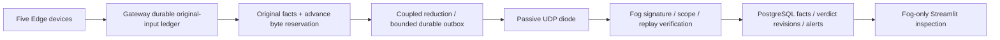

# Faculty Explanation: What Is Being Demonstrated?

Status: proposed research, not established novelty or patentability. See the
[local runbook](local-demo.md), [disclosure draft](invention-disclosure.md) and
[claims-to-evidence matrix](claims-to-evidence.md).

## Problem and Scope

Filtering saves detail/bytes, but silence after filtering cannot establish that a
registered event never occurred. Sequence numbers allocated after reduction cannot
account for original accepted observations. This project tests whether a gateway
can preserve small, precisely scoped rule facts while reducing raw telemetry and
budget the signed evidence **before** committing the irreversible reduction.

The observation population begins only when the gateway durably accepts an input.
Loss at a sensor or before admission is outside that population. A preprovisioned
contract fixes numeric comparisons, units/device sets, ten-second UTC ingress
windows, minimum observations, EXISTS/COUNT_GE and Kleene AND/OR. It does not support
arbitrary code, continuous time or physical simultaneity.

## Mechanism and Responsibilities

The gateway commits original identity, facts, disposition and evidence obligation
at one transactional boundary; unsupported admission is refused. Signed capsules
carry exact declared facts, ingress ranges/counts, scope/contract/key bindings,
limitations, input commitments and predecessor digest. Outbox service charges parts,
signatures, repeats and modeled UDP overhead. The diode forwards bounded frames;
it is not a second semantic decision engine. Fog verifies received evidence and
evaluates rule bounds; missing evidence stays UNKNOWN. Internal Edge/Fog HTTP is
allowed but research cross-boundary transmission is send-only UDP.

Implementation: `shared/coverage/ledger.py`, `admission.py`, `sealing.py`, `budget.py`,
`service.py`, `transport.py`, `udp_runtime.py`, `verification.py`, `fog_store.py`,
`rules.py`, `monitoring.py`; additive migrations 003/004; Fog-only queries in
`shared/persistence/coverage_queries.py`. See phase reports N1-N9 for specific tests.

## How to Read the Outcomes

TRUE means a registered condition's lower bound is sufficient. FALSE means its
upper bound is below the required count **in its covered population**, not that a
network is safe. UNKNOWN means available evidence is insufficient/limited/conflicting.
FALSE in one AND branch does not certify other devices were observed. Severity
and general device health are separate from truth and observation coverage.

N11 demonstrates real admission and Fog receipt, not N10's precomputed-artifact
replay. Missing-raw TRUE illustrates predicate representation without raw delivery;
it is not exact raw reconstruction. The tampering stage changes signed transport
parts and records INVALID_SIGNED_PART. An internally consistent lie signed by the
trusted gateway remains outside cryptographic detection.

## Measurements and Negative Findings

[N10](reports/N10.md) retains 840 model trials: 14 cases x 12 arms x five paired
seeds, original traces/faults/manifests, independent oracle, confidence intervals,
CSV and regenerable PNG/PDF figures. Models are separate from two actual five-pair
UDP artifact-replay studies; neither is advertised as online gateway throughput.
Packets are not independent repeated trials. UNKNOWN is neither error nor success.

There were zero wrong definite decisions in 13,860 supported-arm model
opportunities; two false FALSE answers occurred in the deliberately unsafe
mean-ablation harness. Zero observed errors is not a correctness proof.

RCCD tied the matched-format fixed-summary control in all fourteen case means.
Compact exact signed summaries had higher mean decision yield in twelve cases
and tied in two. Near capacity RCCD yield was 0.7 versus compact 1.0, with mean
wire bytes 353,588.8 versus 310,832.2. The paired RCCD-minus-compact yield interval
was [-0.4154, -0.1846]. The final actual UDP paired yield difference was zero,
descriptive 95% interval [-0.09754, +0.09754]. These results do **not** establish
that the coupling earns its richer evidence cost. Keep this stronger baseline.

The demonstration's deliberately low local message-capacity estimator triggers
routine reduction. It is not an additional performance experiment. Evidence cost,
finite storage and finite signing history remain visible. N10 uses different
explicit shares/capacities for its small-link studies; do not pool those settings.

## Limits and Review Decision

AUTHENTICATED_SUMMARY is an authenticated assertion by a trusted gateway. Offline
raw audit/oracle recomputation is a separate check; Fog cannot recover hidden inputs
from a digest. State loss, clock discontinuities, missing metrics and partial
windows constrain negative decisions. No unconditional delivery guarantee exists.

Docker memberships and failed reverse application probes provide software
isolation evidence, not a physically one-way channel. UDP supports bidirectionality;
the application does not reply. A privileged host can alter networks, mounts,
keys and binaries. Loopback dashboard access is a local operator exception, not
a Fog-to-Edge policy feedback path.

The engineering remains useful as a bounded correctness/audit experiment. Stop
performance-superiority and established-novelty claims. Faculty should review the
negative comparisons, contribution record and closest art before deciding whether
further research or professional patent assessment is worthwhile. Nothing is filed
or published by this phase.
