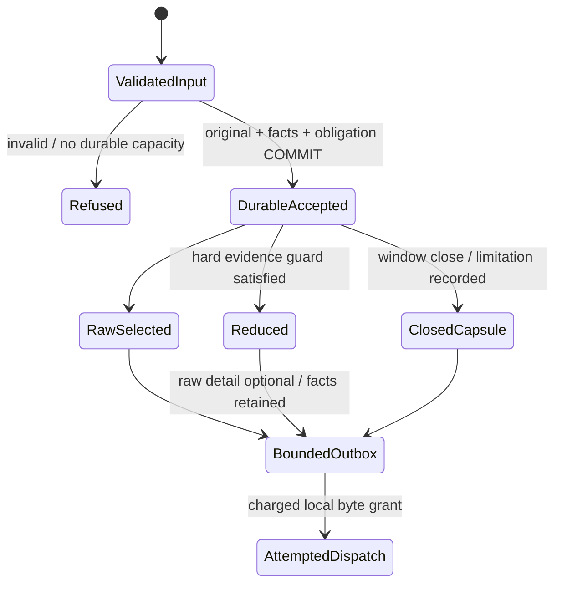
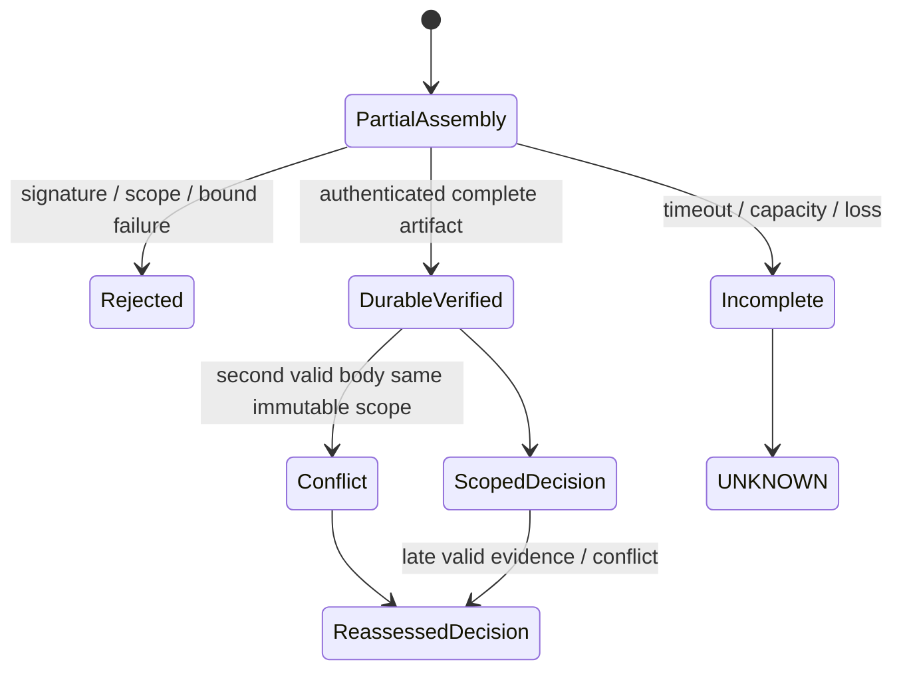

# Draft Technical Disclosure

**NOT FILED. NOVELTY UNESTABLISHED.** Internal faculty-review draft, prepared
2026-10-15; this is a document date, not a filing/priority date. No patent number,
legal opinion, attorney approval, inventor designation or freedom-to-operate
clearance is asserted. No submission/publication is authorized by this document.

Working title: **Atomic Fact-and-Byte Admission for Rule-Scoped Reduced Forward
Telemetry**. Candidate implementation label: Rule-Coverage Data Diode (RCCD).

## Technical Problem

Irreversible raw-data reduction and forward-link loss make absence of received raw
events ambiguous. Post-filter transport sequences do not enumerate gateway ingress.
Sending signed summaries afterward can itself exceed finite storage/link capacity.
The proposed narrow method couples durable original predicate accounting with a
bounded advance evidence storage/forward-byte obligation at reduction admission.
The inquiry is this coupling, not ownership of software diodes, signatures, rule
summaries, reservation scheduling or UNKNOWN monitoring individually.

## Proposed Method and Actual Implementation

1. Provision immutable rule/key/epoch bindings. Accept only supported finite
   numeric predicates, bounded device/rule counts and UTC-aligned ten-second ingress
   windows. No receiver-driven configuration or arbitrary temporal expressions.
2. On accepted input, allocate `(ledger_epoch, device_id, ingress_sequence)` before
   filtering, separate from outgoing UUID/transport sequence. Persist canonical
   original/facts/window/disposition/reservation atomically in Edge-only SQLite.
3. Candidate SAMPLE/AGGREGATE/SUPERSEDE/DROP hooks require original facts and the
   bounded eventual evidence obligation. Reject or expose limitation if unsupported.
   Merely increasing a utility score does not satisfy this hard admission constraint.
4. Seal immutable independently signed capsules. Reconcile conservative reserved
   cost with serialized body, signature, bounded signed parts and fixed repeats.
   Preserve raw selection/attempt/receipt distinctions and reduction accounting.
5. Service evidence, protected and routine byte lanes from bounded durable outbox
   state. Inputs are Edge-local clock/queue/originals and provisioned capacity only.
   Idle borrowing has bounded later-service rules, conditional on admitted load.
6. Passively forward datagrams <=1,200 bytes; no ACK/NACK/missing-part request or
   cross-boundary HTTP readiness exchange in research mode. Charge all configured
   attempts and repeats; local send success does not prove receiver receipt.
7. Fog authenticates canonical parts/capsules, provisioned contract/scope/counts,
   freshness and durable reorder-aware identity. Conflicting valid signed bodies
   quarantine a scope. Duplicate acceptance/publication is idempotent and recoverable.
8. Persist facts and versioned rule decisions. Sufficient lower/upper bounds yield
   TRUE/FALSE; missing/limited/conflicting evidence yields justified UNKNOWN. Later
   independent scopes remain usable despite predecessor gaps. Alerts refer to
   exact decisions/evidence; severity and coverage health remain independent.

The [claims-to-evidence matrix](claims-to-evidence.md) maps these steps to files,
phase tests and measurements. [N11 runbook](local-demo.md) specifies actual Docker
packaging and controls. HTTP, legacy analytics and original experiment baselines
remain available independently. N11 adds fixtures/packaging, not new predicate logic.

## State Machines and Figures

Figure 1: architecture in [faculty explanation](faculty-explanation.md).
Figures 2/3: state machines above. Quantitative figures and raw CSV are in
`experiments/results/coverage/n10-closeout-analysis-20261015/`, regenerated from
signed artifacts and original traces. These figures include costs/negative results,
not illustrations of guaranteed superiority. N11 live receipts are indexed in
[N11 report](reports/N11.md), including exact windows, support and limitations.

## Experiments and Findings

N1-N9 test hashing, Kleene semantics, independent finite-trace oracle, durable
transactions/crashes, bounds, signatures, forks, loss, reordering and software
isolation. N10 adds paired workloads/faults/budgets, five trials/configuration,
ablation arms and descriptive paired Student-t 95% intervals. Models, actual UDP
artifact replay and N11 native gateway demonstration are distinct evidence types.

N10 does not show a yield advantage: RCCD ties matched-format summaries in all
fourteen separate case means, and compact exact signed summaries exceed its mean
yield in twelve and tie in two. See [N10 report](reports/N10.md) for all data,
confidence intervals and source-batch limitations. Do not reinterpret richer
commitment metadata as a measured yield win. N11 is functional evidence, not a new
statistical comparison. No tested zero-error observation proves universal correctness.

## Closest Art and Remaining Distinction

The dated [prior-art register](prior-art.md) and full-publication/claim notes in
[N0 review](reports/N0-prior-art-review.md) are incorporated, not replaced by this
draft. They identify overlapping diode adaptation/filtering/manifests,
window-aware load shedding, proof-infused streams, out-of-order runtime verification,
and authenticated telemetry/negative evidence proposals. Patent publication,
granted claims and public specification are distinct categories. Current legal
status/families are not certified by this review.

Particularly relevant: VLDB 2006 Window-Aware Load Shedding and VLDB 2007
Proof-Infused Streams; diode/manifests documents US9736121B2 and US11641327B2;
CN107078970B and EP4437713A1; and the authenticated-telemetry references listed
with uncertainty in the register. Their semantic/transport pieces create a serious
**obvious-combination risk** even if no reviewed single document expressly describes
this exact transactional reservation boundary. An unsuccessful search is not a
novelty result. No broad claim text is offered here.

## Alternative Embodiments, Not Implemented Claims

Potential alternatives include another transactional store, different bounded
partitioning of the evidence service lane, predicate-specific compact certificates,
or hardware-enforced forward transport. Such variants need independent budgets,
semantics, implementation and evaluation. Continuous-time predicates, arbitrary
expressions, neural inference, hostile-gateway truth detection, physical isolation
and unbounded guaranteed delivery are not implemented by this candidate.

## Assurance and Operational Limits

The trusted signer may fabricate a consistent hidden-input summary. A signature or
commitment cannot reveal that lie without independently available inputs. Scope is
accepted gateway ingress only, not original sensor completeness. Aggregate means
are not exact threshold evidence. Startup/interrupted/clock-jump windows carry
limitations; no-input windows do not satisfy required observation counts.

Finite bandwidth, storage, partial assemblies and raw/evidence queues can overflow.
Admission/coverage must refuse or degrade honestly. N4's 256-entry signing history
and missing phase report remain long-run limitations; the local demo is bounded.
Docker/UDP provides application/software isolation, not physical one-way assurance
or protection from a privileged host. N11's fixed local fault harness is isolated
from baseline mode and does not grant a Fog-to-Edge control interface.

## Legal and Disclosure Review, Not Legal Advice

Patentability depends on the actual claimed subject matter, prior art, inventive
step and the applicable jurisdiction. WIPO describes these distinct requirements
and the country-specific treatment of software inventions. A technical prototype
or an absence of observed errors does not settle them.
[WIPO patent FAQ](https://www.wipo.int/en/web/patents/faq_patents), accessed 2026-10-15.

India's Section 3(k) excludes mathematical/business methods, computer programmes
per se and algorithms; assessment of a specific computer-related technical method
requires current professional advice, not a blanket promise that networking code
is eligible. [IP India Section 3](https://ipindia.gov.in/acts/patent-act-1970/section-3),
accessed 2026-10-15. Other jurisdictions differ.

Patentability is not freedom to operate: a product can still implicate third-party
rights even if a narrower improvement is patentable. FTO review considers relevant
claims, territories, status and intended activities.
[WIPO FTO explanation](https://www.wipo.int/en/web/wipo-magazine/articles/ip-and-business-launching-a-new-product-freedom-to-operate-34956),
accessed 2026-10-15.

The conversation references an existing GitHub repository, but this phase has not
audited public accessibility, earlier publications or priority dates. Faculty and
qualified counsel must review actual disclosure history and filing/publication
order before any further sharing. No code push, paper submission, patent filing
or external deployment is performed in N11.

## Contributions and Review Gates

See [human contribution record](contributions.md). No inventor is named. Faculty
approval, a complete provenance interview, ownership obligations, jurisdiction,
claim analysis and any public-disclosure history remain unverified. Given N10's
negative comparison, stop performance-superiority claims; keep novelty unestablished.
Continuing a useful reproducible research demonstration is not a filing recommendation.
