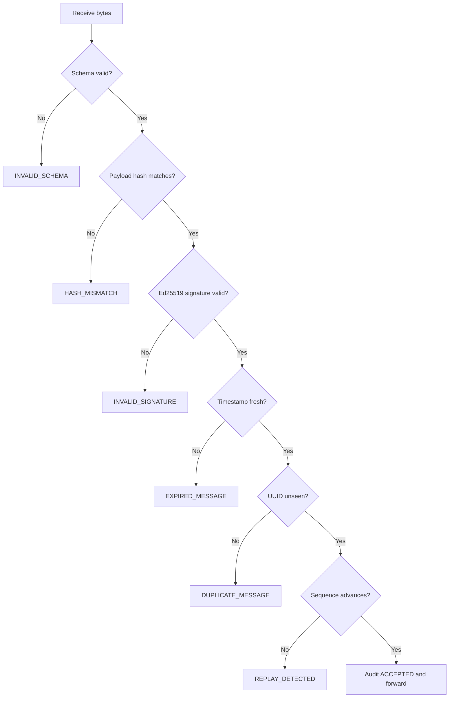
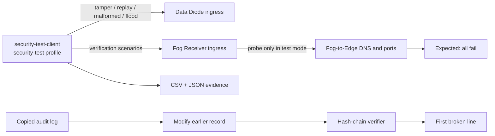

# Security Design

## Controls

- Ed25519 signs a canonical representation of each secure envelope.
- SHA-256 binds the telemetry payload to `payload_hash`.
- Pydantic applies strict schema and size constraints before Fog processing.
- Timestamp freshness, UUID duplicate detection, and per-device monotonic
  sequences reject stale or replayed data.
- Token-bucket admission and egress controls protect the bounded diode queue.
- Priority-aware overflow can evict lower-priority entries for a higher-priority
  arrival; a LOW arrival cannot evict existing work.
- Each service emits structured JSON logs. Gateway, diode, and receiver audit
  files use a chained SHA-256 record format.
- Runtime signing keys and `.env` credentials are generated locally, ignored by
  version control, and mounted only where required.
- Containers run as UID/GID 10001, drop Linux capabilities, use
  `no-new-privileges`, read-only roots, bounded `/tmp`, and resource limits.

## Message Verification

Rejections are audited locally before rejection metadata is persisted. If
PostgreSQL is offline, the security response and audit record are preserved and
the persistence error is logged.

## Controlled Attack Simulation

The test client is attached only to the two intentional ingress networks. It
rejects targets other than the literal Compose hosts `data-diode` and
`fog-receiver`; no external system is targeted.

## Secret Handling

Run `python scripts/setup.py` to create random local credentials and signing
keys. Do not put `.env` or `secrets/*.pem` in a commit, image, report, or
screenshot. Rotate by stopping the stack, replacing `.env` values and both key
files, then rebuilding/restarting the affected services.

## Security Claim

This design demonstrates cryptographic integrity, replay resistance, bounded
resource use, audit tamper evidence, and Docker-network isolation. The Docker
host administrator remains in the trusted computing base and can reconfigure
networks or mounts.

